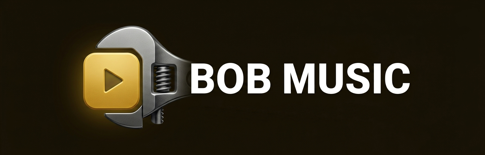
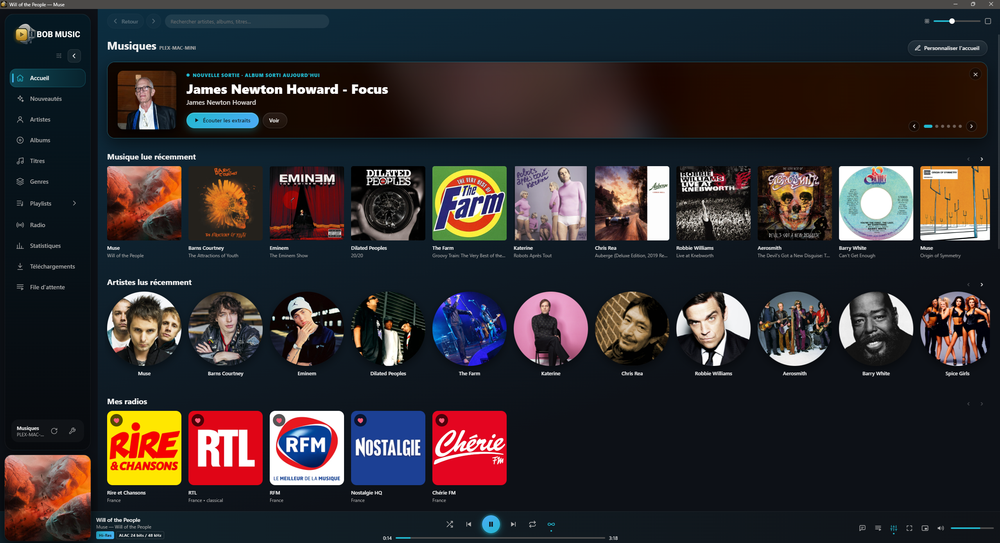
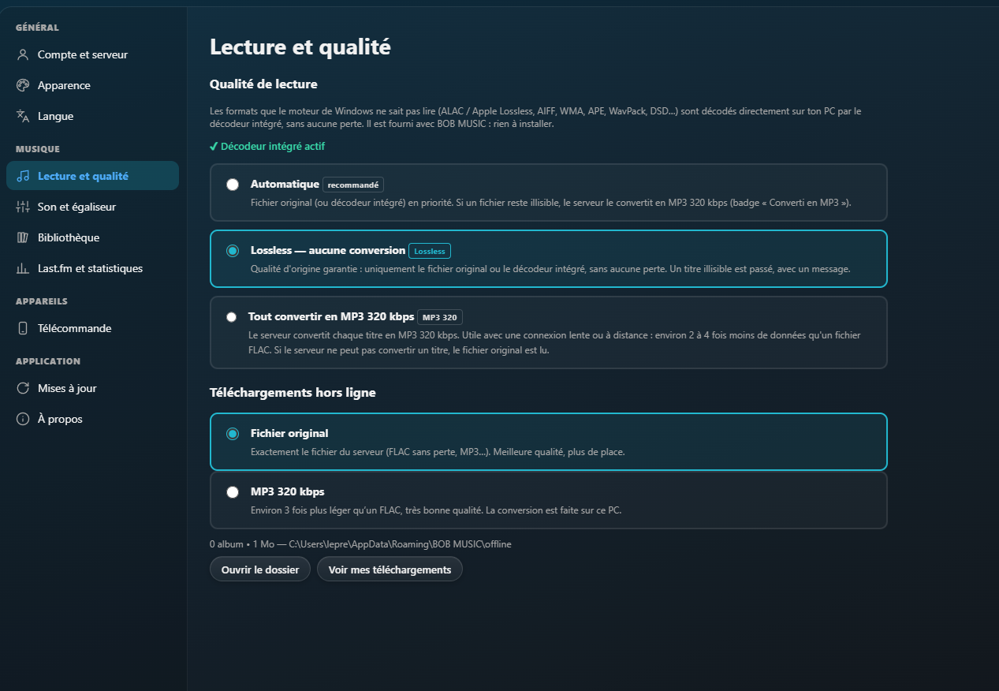
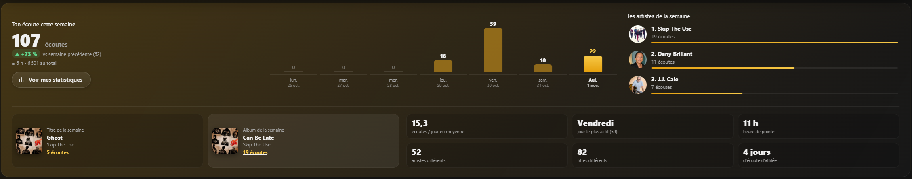
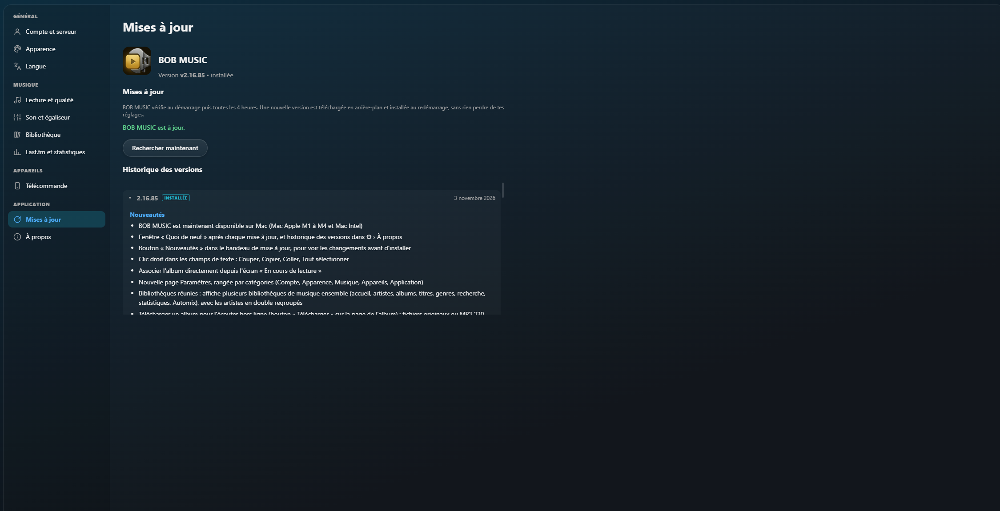

  

  <b>Le lecteur de musique de bureau pour ton serveur Plex.</b> 
  Qualité Lossless, statistiques d'écoute, nouveautés de tes artistes, et mises à jour automatiques.

  <a href="https://github.com/BOB-MUSIC/BOBMUSIC/releases/latest"><b>⬇️ Télécharger la dernière version</b></a>
  &nbsp;•&nbsp; Windows 10 / 11 et macOS &nbsp;•&nbsp; Gratuit

  

---

## ✨ En bref

BOB MUSIC se connecte à ton serveur **Plex** et te donne accès à toute ta bibliothèque musicale dans une application **Windows et Mac** rapide et élégante :
artistes, albums, titres, playlists, recherche, file d'attente… avec une vraie attention portée à la **qualité du son**.

## 📥 Installation

### 🪟 Sur Windows

1. Va sur la page des **[versions (Releases)](https://github.com/BOB-MUSIC/BOBMUSIC/releases/latest)**.
2. Dans la partie **Téléchargements**, prends l'**Installateur Windows** (`BOB-MUSIC-Setup-x.y.z.exe`).
3. Lance-le et suis l'installation : pas besoin d'être administrateur. Les raccourcis Bureau et menu Démarrer sont créés.

> **Windows affiche « Windows a protégé votre ordinateur » ?**
> C'est normal pour un logiciel indépendant non signé. Clique sur **Informations complémentaires → Exécuter quand même**.

### 🍎 Sur Mac

1. Sur la même page, dans **Téléchargements › macOS**, prends :
   - **`BOB-MUSIC-x.y.z-mac-arm64.dmg`** pour un Mac **Apple** (M1, M2, M3, M4) ;
   - **`BOB-MUSIC-x.y.z-mac-x64.dmg`** pour un Mac **Intel**.
   (Menu  › *À propos de ce Mac* indique « Puce Apple » ou « Processeur Intel ».)
2. Ouvre le `.dmg` et **glisse BOB MUSIC dans le dossier Applications**.
3. Ouvre **Applications** et double-clique sur BOB MUSIC. Un message dit qu'Apple n'a pas pu vérifier l'app : clique sur **Terminé**.
4. Ouvre **Réglages Système › Confidentialité et sécurité** et descends jusqu'à la partie **Sécurité**.
5. À côté de « BOB MUSIC a été bloqué… », clique sur **Ouvrir quand même**, puis confirme avec ton mot de passe (ou ton empreinte).
6. Dans la fenêtre suivante, clique sur **Ouvrir**. C'est fait : BOB MUSIC s'ouvrira ensuite normalement, sans rien redemander.

> Ce message apparaît parce que BOB MUSIC n'est pas distribué par l'App Store : l'app ne contient rien de dangereux.

**Version portable :** le fichier `BOB-MUSIC-x.y.z-portable.exe` se lance sans installation, depuis une clé USB par exemple. Elle ne se met pas à jour toute seule.

## 🔑 Première connexion

- Clique sur **Se connecter avec Plex** : ton navigateur s'ouvre, connecte-toi et autorise l'application.
- BOB MUSIC trouve tes serveurs et tes bibliothèques musicales automatiquement.
- La connexion est mémorisée pour les fois suivantes.

Tu peux aussi te connecter **manuellement** avec l'adresse du serveur (ex. `http://192.168.1.10:32400`) et ton jeton `X-Plex-Token`.

## 🎧 Qualité de lecture : Lossless, sans rien installer

BOB MUSIC lit le **fichier original**. Les formats que Windows ne sait pas lire (ALAC / Apple Lossless, AIFF, WMA, APE, WavPack, DSD…) sont décodés **sur ton ordinateur (PC ou Mac), sans aucune perte**, par le décodeur intégré. Il est **fourni avec l'application** : aucun codec à installer.

Dans **⚙ → Lecture et conversion**, choisis ton mode :

| Mode | Pour qui ? |
|---|---|
| **Automatique** (recommandé) | Le meilleur des deux : l'original en priorité, et une conversion en MP3 320 kbps seulement si un fichier est illisible. |
| **Lossless** | Les puristes : jamais de conversion, la qualité d'origine garantie. |
| **Tout en MP3 320 kbps** | Les connexions lentes ou l'écoute à distance : 2 à 4 fois moins de données. |

Des badges indiquent la qualité du titre en cours : *Sans perte*, *Hi-Res*, *MP3 320 kbps*…

## 📊 Statistiques d'écoute (Last.fm)

Relie ton compte **Last.fm** (⚙ → Last.fm et statistiques) pour obtenir :

- un **résumé de la semaine** sur l'accueil : nombre d'écoutes, comparaison avec la semaine précédente, graphique jour par jour, artistes, titre et album de la semaine ;
- une page **Statistiques** complète : artistes, albums et titres les plus écoutés, écoutes par jour et par heure, écoutes récentes ;
- des périodes au choix : **Aujourd'hui, 7 jours, 1 mois, 3 mois, 6 mois, 12 mois, depuis toujours** ;
- l'envoi de tes écoutes à Last.fm (scrobbling).

## 🎵 Toutes les fonctions

- **Accueil personnalisable** : glisse-dépose les catégories et les modules (Nouveautés, Statistiques), masque ce que tu ne veux pas voir, ajoute des rangées par genre, décennie ou playlist.
- **Nouveautés** : les albums, EP et singles récents ou à venir de tes artistes préférés, avec écoute des extraits.
- **Page artiste** : titres populaires, discographie, biographie traduite automatiquement.
- **Paroles** synchronisées, écran « En cours de lecture » plein écran.
- **Automix** ∞ : quand la file d'attente se termine, la musique continue avec des titres similaires de ta bibliothèque.
- **Mini lecteur** détachable et toujours visible ; boutons de lecture dans la barre des tâches (Windows) et progression sur l'icône du Dock (Mac).
- **Touches multimédia** du clavier, panneau média du système, boutons Précédent / Suivant de la souris.
- **Raccourcis** : `Espace` lecture/pause, `← / →` ±10 s, `Ctrl + ← / →` titre précédent/suivant.
- **10 thèmes** en dégradé et un thème sur mesure.
- **Gérer ta bibliothèque** (réservé au propriétaire du serveur Plex) : modifier titres, jaquettes et genres, **corriger l'association** d'un album ou d'un artiste comme dans Plex (avec la liste des titres pour comparer), **fusionner** les albums en double ou les **séparer**, actualiser la bibliothèque.
- La lecture apparaît dans le **tableau de bord Plex** (« En cours de lecture »), et les titres écoutés sont marqués comme lus.
- Application en **français** et en **anglais**.

## 📱 Télécommande sur ton téléphone

Pilote BOB MUSIC depuis ton **iPhone** ou ton **Android**, sans rien installer : dans **⚙ › Télécommande**, active-la et scanne le QR code (téléphone sur le même Wi-Fi).
Lecture, file d'attente, recherche, albums et artistes, playlists, volume, qualité audio, **paroles synchronisées en plein écran**… Ajoute-la à l'écran d'accueil pour l'avoir comme une appli.
Plusieurs ordinateurs avec BOB MUSIC ? Passe de l'un à l'autre depuis la télécommande.

## 🔄 Mises à jour automatiques

**Windows (version installée)** : BOB MUSIC vérifie tout seul s'il existe une nouvelle version, au démarrage puis toutes les 4 heures, la télécharge en arrière-plan et te propose de **redémarrer** pour l'installer.
**Mac** : BOB MUSIC te prévient et te donne le lien du bon fichier ; il suffit de remplacer l'appli dans Applications.
Dans les deux cas, tes réglages sont conservés.

Ta version est affichée en bas du menu **⚙** et dans **⚙ → À propos et mises à jour**.

## ❓ Questions fréquentes

<b>Faut-il un abonnement Plex Pass ?</b>

Non. Il faut simplement un serveur Plex avec une bibliothèque de musique, et un compte qui y a accès.

<b>Pourquoi je ne peux pas modifier les albums ?</b>

Seul le <b>propriétaire</b> du serveur Plex peut modifier les informations de la bibliothèque. Si le serveur t'est partagé, ces boutons sont masqués.

<b>Un titre est passé avec un message « conversion désactivée »</b>

Tu es en mode <b>Lossless</b> et ce fichier est illisible sans conversion. Passe en mode <b>Automatique</b> dans ⚙ → Lecture et conversion.

<b>Comment profiter du Hi-Res (24 bits / 96 kHz et plus) ?</b>

BOB MUSIC passe par le mixeur audio du système. Règle la fréquence de ta sortie audio : 
<b>Windows</b> : <i>Paramètres → Son → ton périphérique → Format</i> (ex. 24 bits, 96 000 Hz). 
<b>Mac</b> : application <i>Configuration audio et MIDI</i> → ta sortie → <i>Format</i>.

<b>Comment désinstaller ?</b>

<b>Windows</b> : Paramètres → Applications → <b>BOB MUSIC</b> → Désinstaller. 
<b>Mac</b> : glisse <b>BOB MUSIC</b> depuis Applications vers la Corbeille.

---

BOB MUSIC est un projet indépendant, non affilié à Plex Inc. ni à Last.fm.

