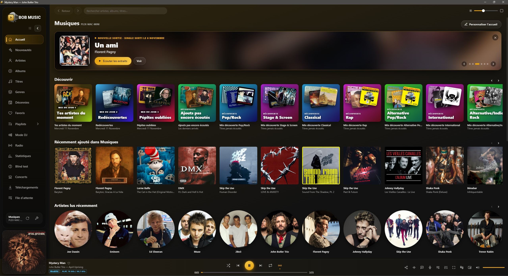

# 🎧 BOB MUSIC

**Le lecteur de musique de bureau pour ton serveur Plex.**
Son haute fidélité, mode DJ, radios, podcasts, paroles, statistiques… tout ta musique, au même endroit.

**[⬇️ Télécharger la dernière version](https://github.com/BOB-MUSIC/BOBMUSIC/releases/latest)**

Windows 10 / 11 · macOS (Apple M1 à M4 et Intel) · Gratuit

 

---

## ✨ En bref

- 🎵 **Toute ta bibliothèque Plex**, dans une appli rapide et soignée : artistes, albums, titres, genres, décennies, playlists.
- 🔊 **Un son sans compromis** : lecture sans perte, Hi-Res, **mode bit-perfect** et chemin du son affiché étape par étape.
- 🎛️ **Mode DJ** à deux platines, avec mix automatique.
- 📻 **Des milliers de radios et de podcasts**, avec des logos en haute définition.
- 🎤 **Paroles synchronisées**, traduites en un clic, et un **mode karaoké** plein écran.
- 📊 **Tes statistiques d'écoute** et ton **BOB Wrapped** de l'année.
- 📱 **Télécommande sur ton téléphone**, sans rien installer.

---

## 🔊 Pour les amoureux du son

| | |
|---|---|
| **Sans perte et Hi-Res** | FLAC, ALAC, WAV, AIFF, DSD… lus tels quels, jusqu'en 24 bits / 192 kHz, grâce au décodeur intégré. |
| **Mode exclusif (bit-perfect)** | Le son part directement vers ta carte son ou ton DAC, à la fréquence d'origine de chaque titre, sans que Windows ou macOS le rééchantillonne. BOB peut installer lui-même le moteur nécessaire (mpv). |
| **Chemin du son** | Du fichier jusqu'à l'enceinte : chaque étape, sa qualité, et l'endroit exact où la qualité baisse s'il y en a un. |
| **Correction du casque (AutoEQ)** | Choisis ton casque parmi plus de 4 000 modèles mesurés : BOB corrige ses défauts pour un son neutre. |
| **Égaliseur 10 bandes** | Préréglages, préampli, limiteur, sortie audio au choix (casque, DAC USB, HDMI…). |
| **Volume égal et enchaînements** | Volume homogène d'un titre à l'autre (ReplayGain), enchaînement sans blanc, fondus et mix entre les titres. |
| **Classement par qualité** | Trie tes albums par qualité, échantillonnage ou format. |

## 🎛️ Mode DJ

Deux platines avec vinyles animés et effet scratch, tempo, boucles, repères, égaliseur 3 bandes et filtres. Le **mix automatique** enchaîne tout seul par genre, décennie ou artiste, sans toucher à la vitesse ni à la tonalité. Moments de soirée en couleur, recherche dans toute ta bibliothèque, enregistrement de ton mix.

## 📻 Radios et podcasts

- Des **milliers de radios** de France et du monde, par pays ou par genre, avec les grandes radios françaises en tête et des **logos officiels en HD**.
- Les **podcasts** : recherche dans l'annuaire d'Apple Podcasts, les plus écoutés en France, abonnements, nouveaux épisodes, **reprise là où tu t'étais arrêté**, vitesse de lecture, −15 s / +30 s. Import de tes abonnements depuis une autre appli.

## 🎤 Paroles et karaoké

- **Paroles synchronisées** qui défilent avec la chanson, en grand en plein écran.
- **Traduction des paroles** en un clic, sous chaque ligne.
- **Mode karaoké** : la ligne se remplit au rythme du chant, voix atténuée réglable, décompte pendant les passages instrumentaux.

## 🧭 Découvrir et redécouvrir

- **Mix du jour** : tes artistes du moment, des titres oubliés, des albums jamais écoutés de tes genres préférés.
- **Découvrir** par genre, **Nouveautés** de tes artistes et **classements** Deezer.
- **Fiches enrichies** : biographies en français, crédits des albums (musiciens, producteur, studio), fiche des artistes, concerts près de chez toi.
- **Radio d'artiste**, Automix, favoris, notes, téléchargement pour l'écoute hors ligne.

## 📊 Statistiques et jeux

- **Statistiques d'écoute** et **BOB Wrapped**, ton année en musique, à partager en image.
- **Blind test** entre amis, chacun répond depuis son téléphone, avec une version pour les enfants.
- **Last.fm** : scrobbles et historique.

## 🏠 À la maison

- **Télécommande** sur ton téléphone : il suffit de scanner un QR code.
- **Multiroom** : la même musique sur plusieurs PC, synchronisée.
- **Commande vocale** (Windows) : « suivant », « mets du Clapton », « lance la playlist Soirée »…
- **Mini-lecteur** et intégration aux touches multimédia du clavier.

## 🧹 Une bibliothèque impeccable

Le **réparateur de fiches** trouve les albums sans pochette, sans année ou sans genre, les artistes sans photo, les albums en double et les artistes écrits de plusieurs façons, puis les corrige en un clic dans Plex.

---

## ⬇️ Installation

### Windows
1. Télécharge **`BOB-MUSIC-Setup-….exe`** dans la [dernière version](https://github.com/BOB-MUSIC/BOBMUSIC/releases/latest).
2. Lance-le. Si Windows affiche « Windows a protégé votre ordinateur », clique sur **Informations complémentaires**, puis **Exécuter quand même** (BOB n'est pas distribué par le Microsoft Store).
3. Connecte-toi avec ton compte Plex : BOB trouve ton serveur et ta musique tout seul.

Une version **portable**, sans installation, est aussi disponible.

### macOS
1. Télécharge le **`.dmg`** qui correspond à ton Mac : **arm64** pour les puces Apple M1 à M4, **x64** pour les Mac Intel.
2. Ouvre-le et glisse **BOB MUSIC** dans **Applications**.
3. Au premier lancement : **Réglages Système › Confidentialité et sécurité › Ouvrir quand même**.

### Mises à jour
BOB se met à jour tout seul : un bandeau te prévient quand une nouvelle version est prête, avec la liste des nouveautés.

---

## ❓ Questions fréquentes

**Faut-il un abonnement Plex Pass ?**
Non. Il te faut seulement un serveur Plex avec ta musique et un compte Plex gratuit.

**Ma musique part-elle sur Internet ?**
Non. BOB lit ta musique directement sur ton serveur Plex. Seules quelques infos (pochettes manquantes, paroles, biographies…) sont demandées à des services publics.

**Certaines fonctions demandent une clé ?**
Oui, trois fonctions facultatives demandent ta propre clé gratuite : **Last.fm** (statistiques), **YouTube** (clips) et **Ticketmaster** (concerts). BOB t'explique comment l'obtenir en une minute.

**Une fonction ne marche plus ?**
Va dans **Paramètres › À propos › État des services** : tu vois tout de suite si un service extérieur est en panne. Ta musique, elle, ne dépend que de ton serveur Plex.

**Je veux signaler un problème.**
Active le **mode debug** (Ctrl + Maj + D), reproduis le problème, exporte le journal et ouvre une [issue](https://github.com/BOB-MUSIC/BOBMUSIC/issues) en le joignant. Les mots de passe et jetons y sont masqués.

---

## 🙏 Sources et crédits

BOB MUSIC s'appuie sur des services gratuits, utilisés dans le respect de leurs conditions d'usage **non commercial** :

| Service | Utilisé pour |
|---|---|
| [Plex](https://www.plex.tv) | ta bibliothèque musicale |
| [Deezer](https://developers.deezer.com) | nouveautés, top des titres, extraits de 30 s, pochettes manquantes |
| [Last.fm](https://www.last.fm) | scrobbles et statistiques *(ta clé)* |
| [MusicBrainz](https://musicbrainz.org) | crédits des albums, fiches des artistes |
| [Wikipédia](https://fr.wikipedia.org) et [Wikidata](https://www.wikidata.org) | biographies, présentations, logos de radios |
| [LRCLIB](https://lrclib.net) · [lyrics.ovh](https://lyrics.ovh) | paroles |
| [MyMemory](https://mymemory.translated.net) · Google Traduction en secours | traduction des paroles |
| [Radio Browser](https://www.radio-browser.info) · TuneIn en secours | annuaire et logos des radios |
| [Apple Podcasts](https://podcasts.apple.com) | recherche et classement des podcasts |
| [YouTube](https://www.youtube.com) · [Ticketmaster](https://www.ticketmaster.fr) | clips et concerts *(ta clé)* |
| [AutoEq](https://github.com/jaakkopasanen/AutoEq) | correction des casques |
| [mpv](https://mpv.io) | lecture en mode exclusif (bit-perfect) |
| [Butterchurn](https://github.com/jberg/butterchurn) (MilkDrop) | visualiseur du plein écran |

Merci à toutes ces équipes. 💛

**BOB MUSIC est et restera gratuit, sans publicité ni abonnement.** Les logos des radios et les pochettes appartiennent à leurs propriétaires et servent uniquement à les reconnaître. Un ayant droit souhaite le retrait d'un élément ? Ouvre une [issue](https://github.com/BOB-MUSIC/BOBMUSIC/issues) : ce sera fait rapidement.

---

BOB MUSIC est un projet indépendant, non affilié à Plex, Deezer, Last.fm, Apple, Google, TuneIn ni aux radios citées.

